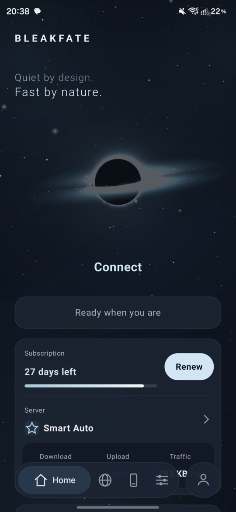
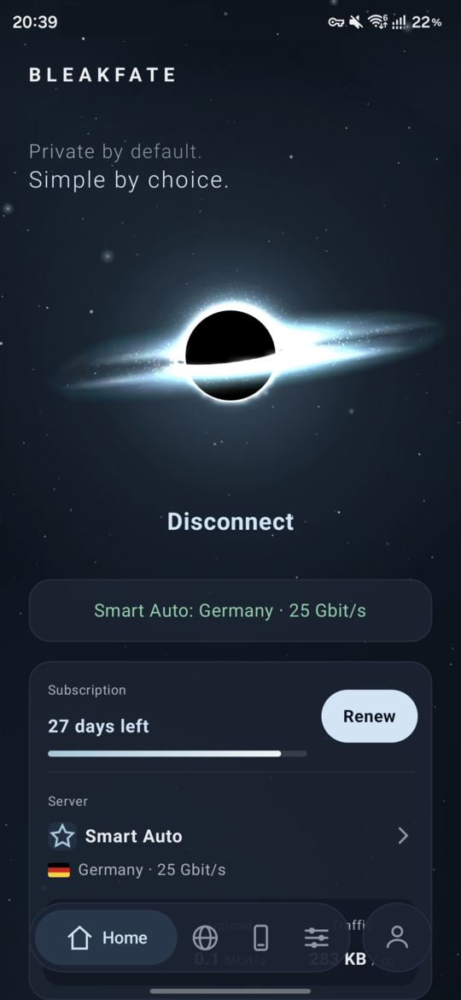
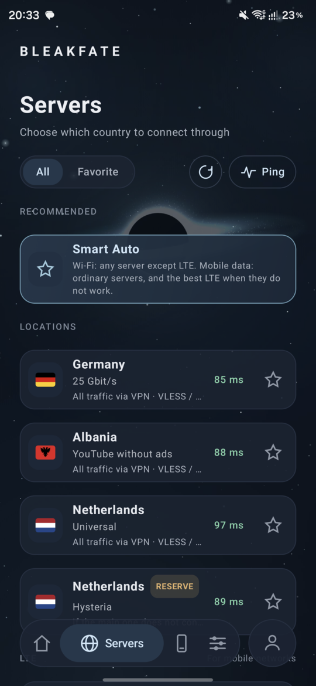
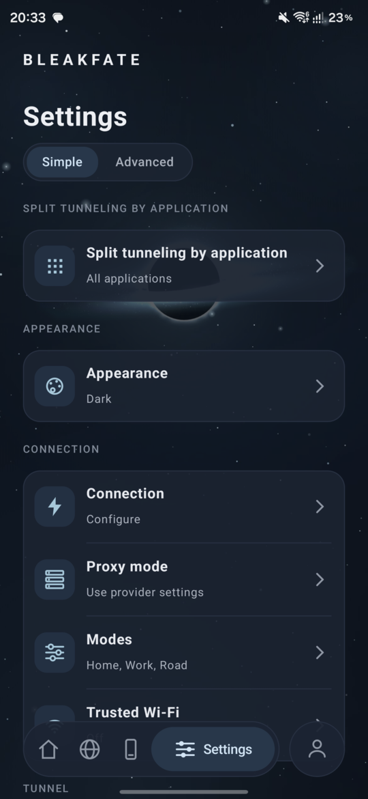

<p align="center">
  
</p>

<h1 align="center">BLEAKFATE for Android</h1>

<p align="center">
  <b>The BLEAKFATE VPN app for Android: sign in, press one button, renew without leaving the app.</b>
</p>

<p align="center">
  Our own Android client for BLEAKFATE VPN, built on the same Xray core that runs on our servers. Your account, subscription, devices and payments live in the app.
  <br><i>This repository holds the releases only: the source code is closed.</i>
</p>

<p align="center">
  <a href="https://github.com/MostViable/bleakfate-android/releases/latest/download/BLEAKFATE.apk"></a>
  
  
  
  
  
</p>

<p align="center">
  <a href="https://github.com/MostViable/bleakfate-android/releases/latest/download/BLEAKFATE.apk"><b>Download BLEAKFATE.apk</b></a> ·
  <a href="README.ru.md"><b>Русская версия</b></a> ·
  <a href="https://bleakfate.com">bleakfate.com</a> ·
  <a href="https://t.me/BleakFateBot">@BleakFateBot</a> ·
  <a href="https://t.me/BleakFateSupportBot">Support</a>
</p>

<p align="center">
  
  
  
  
  <br><sub>Real screenshots of version 0.9.0: Home with the VPN off and on, Servers, Settings.</sub>
</p>

> [!TIP]
> **Try BLEAKFATE free for 3 days.** Install the app, sign in through Telegram or create an account with your email, and tap **Profile → Try for free**. During the three free days you can connect up to 5 devices, and you don't need a card. One trial per account.
>
> Got an invite link from a friend? Open it in Telegram first: [@BleakFateBot](https://t.me/BleakFateBot) remembers who invited you, and new users get a 6-day trial instead of 3, in the bot or in the app when you sign in through Telegram.

> [!NOTE]
> The app is in beta. It needs a BLEAKFATE subscription: sign in with the account you use in the bot or on the website, or paste your subscription link.

<p align="center">
  <a href="#install">Install</a> ·
  <a href="#check-the-file">Check the file</a> ·
  <a href="#updates">Updates</a> ·
  <a href="#what-it-can-do">What it can do</a> ·
  <a href="#privacy">Privacy</a> ·
  <a href="#security">Security</a> ·
  <a href="#license-and-credits">License and credits</a>
</p>

## Install

1. Download [`BLEAKFATE.apk`](https://github.com/MostViable/bleakfate-android/releases/latest/download/BLEAKFATE.apk) from the latest release.
2. Open the file. Android asks to allow installing apps from your browser or file manager: allow it for this installation.
3. Open BLEAKFATE and sign in through Telegram or with your email, or choose "I have a subscription link".

Requires Android 7.0 or newer (arm64-v8a or armeabi-v7a).

## Check the file

Every release has `BLEAKFATE.apk.sha256` next to the APK. All releases are signed with the same key; the SHA-256 of the signing certificate is:

```
b6fa737b90b114ed4144ee2f0c7d00559fcbc81fbe890f59636d3142e93c51f8
```

With the Android SDK: `apksigner verify --print-certs BLEAKFATE.apk` must show this digest. A file signed with any other key is not ours.

## Updates

Since 0.9.0 a new release shows up on **Home** by itself: tap **Download**, then **Install**. The new version downloads from this repository with a progress bar, and Android installs it over the old one; the first time, Android may ask you to allow installs from BLEAKFATE. Your settings, servers and sign-in stay.

You can also check yourself: **Settings → About BLEAKFATE → Check for updates**. On 0.8.5 this is how you get 0.9.0.

You can also download the new `BLEAKFATE.apk` from [Releases](https://github.com/MostViable/bleakfate-android/releases) and install it over the old one yourself.

## What it can do

- **One button** to connect, and **Smart Auto**, which picks a working server for the network you are on.
- **Servers by country**, favourites, ping check and a speed test.
- **Split tunneling**: choose which apps go through the VPN.
- **Everything the Telegram bot does, in the app**: sign in through Telegram or email, your subscriptions with the days left, renew and pay (SBP, card, crypto) with your balance and promo codes, invite friends, a payment history.
- **Your devices**: unlink one or all, block a stranger's device, reissue the link; connect another device with a QR code.
- **Help** with the service status, support and documents.
- **Trusted Wi‑Fi networks** where the VPN switches off, modes such as Home or Work, a leak check.
- **Light and dark themes**, Russian and English.

## Privacy

No ads and no analytics. Error reports go to our server only if you allow them (Settings → Advanced → Connection event log); they hold event codes, the name of a crash, the app version and the phone model, never addresses, subscription links or keys. The speed test talks to `speed.cloudflare.com`. The privacy policy of the BLEAKFATE service is on [bleakfate.com](https://bleakfate.com/legal/privacy/). It does not cover the app yet: what the app sends is listed in this section.

## Security

How to report a vulnerability, what is in scope and how to check that a release is ours: [SECURITY.md](SECURITY.md).

## License and credits

© MostViable. All rights reserved. You may download and use the app with a BLEAKFATE subscription; the source code is not published.

The app uses open-source components under their own licenses: [libXray](https://github.com/XTLS/libXray) (MIT) and [Xray-core](https://github.com/XTLS/Xray-core) (MPL-2.0, unmodified; source of the version used: [v26.10.31](https://github.com/XTLS/Xray-core/tree/v26.10.31)), [hev-socks5-tunnel](https://github.com/heiher/hev-socks5-tunnel) with its modules (MIT, lwIP under BSD-3-Clause), Kotlin, AndroidX and Jetpack Compose, OkHttp, ZXing (Apache-2.0). Full texts: [`THIRD_PARTY_NOTICES.txt`](THIRD_PARTY_NOTICES.txt) and in the app (About BLEAKFATE → Open source licenses).
