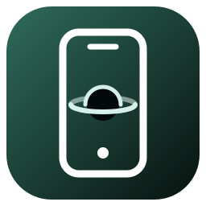
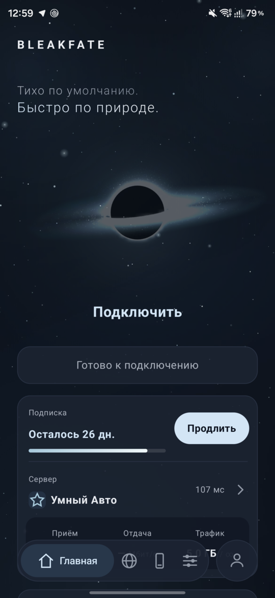
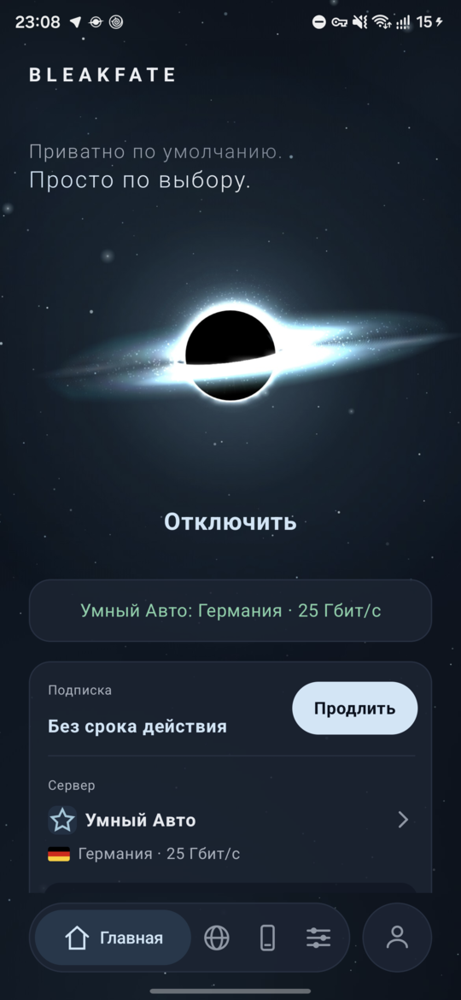
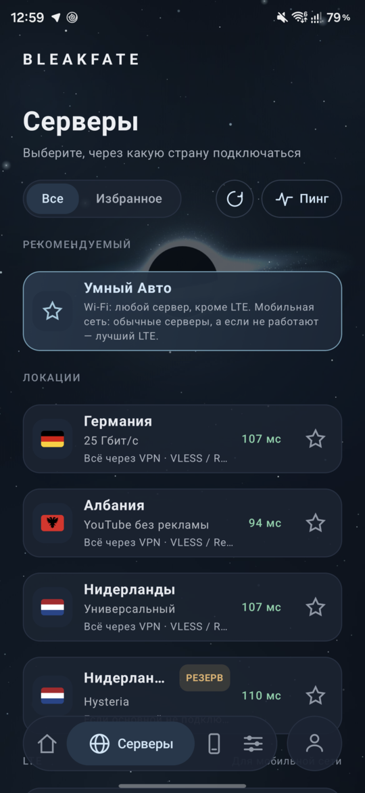
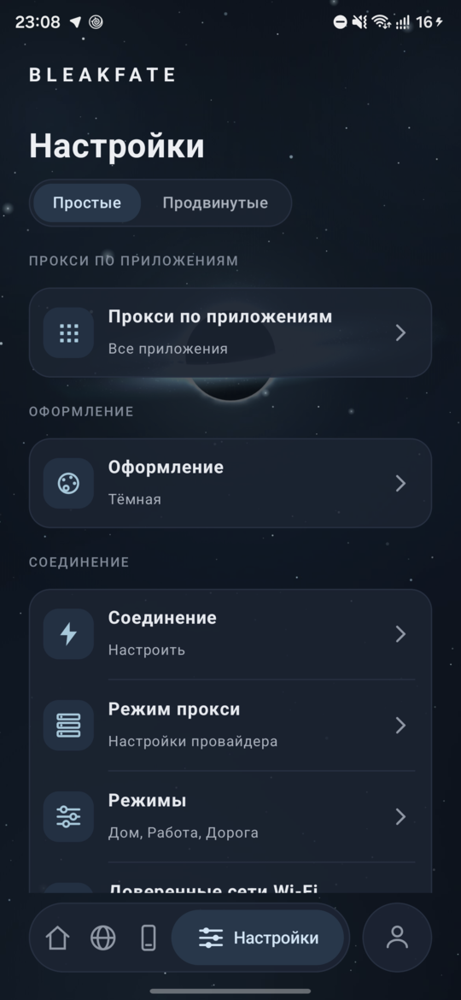

<p align="center">
  
</p>

<h1 align="center">BLEAKFATE для Android</h1>

<p align="center">
  <b>Приложение BLEAKFATE VPN для Android: войдите, нажмите одну кнопку, продлевайте подписку прямо в приложении.</b>
</p>

<p align="center">
  Наш собственный клиент BLEAKFATE VPN для Android на том же ядре Xray, что работает на наших серверах. Аккаунт, подписка, устройства и оплата — в приложении.
  <br><i>Здесь только выпуски: исходный код закрыт.</i>
</p>

<p align="center">
  
  
  
  
  
</p>

<p align="center">
  <a href="https://github.com/MostViable/bleakfate-android/releases/latest/download/BLEAKFATE.apk"><b>Скачать BLEAKFATE.apk</b></a> ·
  <a href="README.md"><b>English</b></a> ·
  <a href="https://bleakfate.com">bleakfate.com</a> ·
  <a href="https://t.me/BleakFateBot">@BleakFateBot</a> ·
  <a href="https://t.me/BleakFateSupportBot">Поддержка</a>
</p>

<p align="center">
  
  
  
  
  <br><sub>Настоящие скриншоты версии 0.8.2: «Главная» с выключенным и включённым VPN, «Серверы», «Настройки».</sub>
</p>

> [!NOTE]
> Приложение в бета-версии. Нужна подписка BLEAKFATE: войдите тем же аккаунтом, что в боте или на сайте, или вставьте ссылку на подписку.

<p align="center">
  <a href="#установка">Установка</a> ·
  <a href="#проверка-файла">Проверка файла</a> ·
  <a href="#обновления">Обновления</a> ·
  <a href="#что-умеет">Что умеет</a> ·
  <a href="#приватность">Приватность</a> ·
  <a href="#лицензия-и-благодарности">Лицензия и благодарности</a>
</p>

## Установка

1. Скачайте [`BLEAKFATE.apk`](https://github.com/MostViable/bleakfate-android/releases/latest/download/BLEAKFATE.apk) из последнего выпуска.
2. Откройте файл. Android попросит разрешить установку приложений из браузера или менеджера файлов — разрешите для этой установки.
3. Откройте BLEAKFATE и войдите через Telegram или по почте, либо выберите «У меня есть ссылка на подписку».

Нужен Android 7.0 или новее (arm64-v8a или armeabi-v7a).

## Проверка файла

В каждом выпуске рядом с APK лежит `BLEAKFATE.apk.sha256`. Все выпуски подписаны одним ключом; SHA-256 сертификата подписи:

```
b6fa737b90b114ed4144ee2f0c7d00559fcbc81fbe890f59636d3142e93c51f8
```

С Android SDK: `apksigner verify --print-certs BLEAKFATE.apk` должен показать этот отпечаток. Файл, подписанный другим ключом, — не наш.

## Обновления

Новый выпуск ставится поверх старого: настройки, серверы и вход сохраняются. Обновление прямо из приложения появится позже, пока берите новый APK в [выпусках](https://github.com/MostViable/bleakfate-android/releases).

## Что умеет

- **Одна кнопка** для подключения и **«Умный Авто»**, который выбирает рабочий сервер под вашу сеть.
- **Серверы по странам**, избранное, проверка задержки и тест скорости.
- **Прокси по приложениям**: выберите, какие приложения идут через VPN.
- **Аккаунт в приложении**: вход через Telegram или по почте, подписка и устройства, продление и оплата (СБП, карта, крипта).
- **Доверенные сети Wi‑Fi**, где VPN выключается, режимы вроде «Дом» и «Работа», проверка утечек.
- **Светлая и тёмная темы**, русский и английский.

## Приватность

Без рекламы и аналитики. Отчёты об ошибках уходят на наш сервер только с вашего согласия (Настройки → Журнал соединения); в них коды событий, название сбоя, версия приложения и модель телефона, но никогда адреса, ссылки подписки или ключи. Тест скорости обращается к `speed.cloudflare.com`. Полная политика — на [bleakfate.com](https://bleakfate.com/legal/privacy/).

## Лицензия и благодарности

© MostViable. Все права защищены. Приложение можно скачивать и использовать с подпиской BLEAKFATE; исходный код не публикуется.

В приложении используются открытые компоненты под их собственными лицензиями: [libXray](https://github.com/XTLS/libXray) (MIT) и [Xray-core](https://github.com/XTLS/Xray-core) (MPL-2.0, без изменений; исходники использованной версии: [v26.10.31](https://github.com/XTLS/Xray-core/tree/v26.10.31)), [hev-socks5-tunnel](https://github.com/heiher/hev-socks5-tunnel) с модулями (MIT, lwIP — BSD-3-Clause), Kotlin, AndroidX и Jetpack Compose, OkHttp, ZXing (Apache-2.0). Полные тексты — в [`THIRD_PARTY_NOTICES.txt`](THIRD_PARTY_NOTICES.txt) и в приложении (О BLEAKFATE → Лицензии компонентов).
